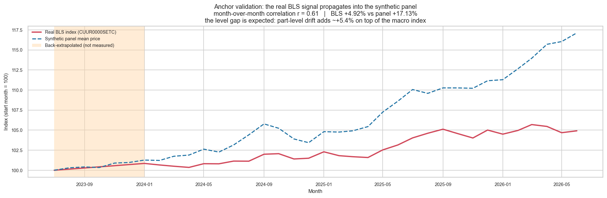
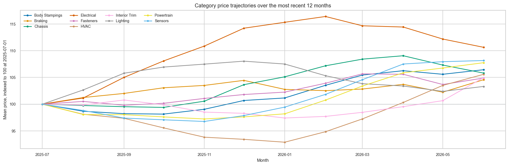
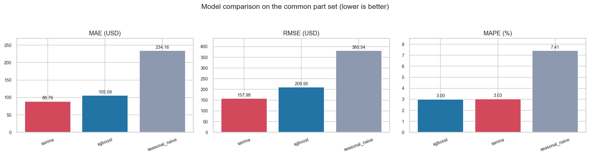
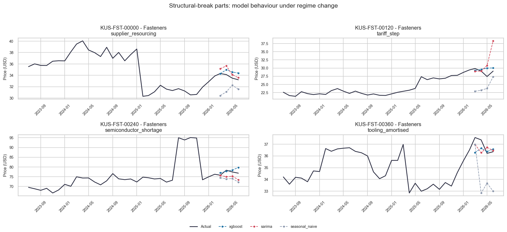
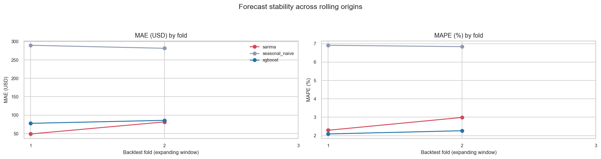
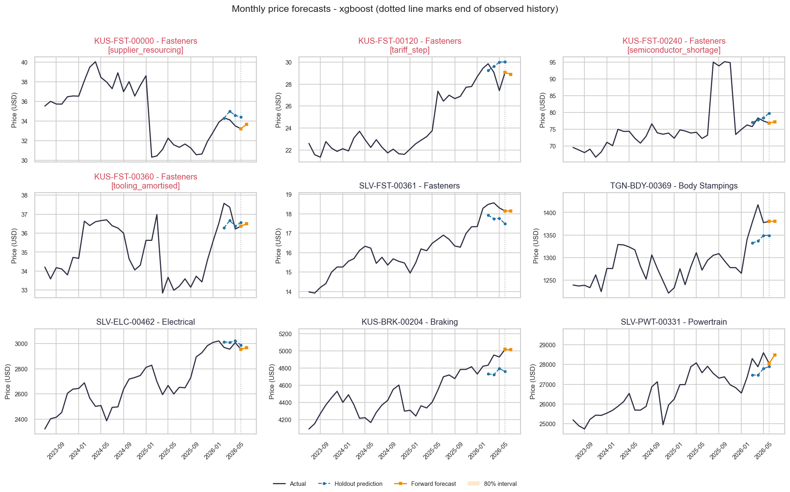

# Automotive Spare Parts - Monthly Price Forecasting (POC)

_Generated 2026-10-22 13:32 UTC_

---

## 1. Summary

End-to-end monthly price forecasting for **480 automotive spare parts** across **10 categories**, over **36 months** (2023-07-01 to 2026-06-01), producing **1-month forward forecasts** with prediction intervals.

### Does this actually work?

- **sarima** improves on seasonal-naive by **62.1%** MAE (88.76 vs 234.16 USD).
- **xgboost** improves on seasonal-naive by **54.9%** MAE (105.59 vs 234.16 USD).

Both learned models are measured against a seasonal-naive baseline (`price[t+h] = price[t+h-12]`). Without that comparison, an impressive-looking MAPE says nothing about whether the modelling added value.

---

## 2. Dataset

### 2.1 Sourcing decision

A search for a public dataset of **monthly prices per automotive SKU** came back empty. The full audit is in [`dataset_audit.md`](dataset_audit.md); in short:

- Kaggle automotive parts datasets are **cross-sectional** - attributes mapped to one price, with no date column and therefore nothing to forecast.
- Hyndman's `carparts` panel has the right shape but the wrong variable: intermittent **demand counts**, not prices.
- FRED carries suitable index series but was **unreachable** from this environment (repeated timeouts).
- The **BLS public API** does serve real monthly automotive price indices, with no API key - but only at **industry-aggregate level**, not per part.

So this POC uses a **hybrid**: the real BLS index drives the trend, and a synthetic SKU layer supplies the per-part structure that no public source offers. The boundary between real and simulated is stated explicitly rather than blurred.

| Property | Value |
|---|---|
| Anchor series | `CUUR0000SETC` |
| Retrieval path | `bls-cache` |
| Grounded in real data | **Yes** |
| Window | 2023-07-01 to 2026-06-01 |
| Back-extrapolated months | 6 |
| Total index change | +4.92% |

> **Caveat**: the BLS public API v1 returns roughly three years of history, leaving **6 month(s)** of the requested window uncovered. Those were extended backwards at the observed mean log drift rather than padded with a repeated value. They are synthetic and are shaded in the anchor-validation figure.




_Synthetic panel mean tracked against the real BLS index_


### 2.2 Generation methodology

Prices are built multiplicatively, because price shocks are proportional - a tariff moves a $240 alternator by more dollars than a $12 oil filter, but by the same percentage:

```
price[i,t] = base[i]                # lognormal, category-specific level
           * macro[t]               # REAL BLS index, normalised to 1.0
           * seasonal[i,t]          # category demand cycle
           * (1 + drift[i]) ** t    # part-specific supply-chain drift
           * exp(noise[i,t])        # AR(1) autocorrelated volatility
           * break[i,t]             # structural break, 4 parts only
```

Seasonality follows real aftermarket demand: batteries and starters peak in January when the first hard freeze exposes weak cells; cooling parts peak in July; suspension work follows the spring pothole season; filters are close to flat. Noise is AR(1) rather than white, so volatility clusters the way real price series do.

**4 parts carry deliberate structural breaks** to test robustness: a permanent supply-shock level shift, a tariff step, a price collapse after a new supplier enters, and a transient spike that reverts.

| Property | Value |
|---|---|
| Parts | 480 |
| Categories | 10 |
| Months of history | 36 |
| Total observations | 17,280 |
| Price range | $13.92 - $28591.08 |
| Random seed | 42 |

> **Why 36 months and not 12?** The brief asked for a year of history. A seasonal SARIMA with a 12-month cycle cannot be identified from 12 observations - it needs at least two full cycles - and an 80/20 split on 12 points leaves about 9 training rows, which is not enough to draw a conclusion from. History is therefore 36 months, while the dataset overview and category figures headline the most recent 12 months.




_Category price trajectories over the focus year_


### 2.3 Data quality handling

| rows_in | parts_in | missing_prices | imputed_by_ffill | unfillable_dropped | outliers_flagged | insufficient_history_parts | n_features | n_hierarchy_features | n_fx_features | n_geo_features |
|---|---|---|---|---|---|---|---|---|---|---|
| 17280 | 480 | 177 | 177 | 0 | 21 | 0 | 68 | 8 | 38 | 32 |

Missing values are forward-filled within a part across gaps of at most 2 months; longer gaps are left as NaN and excluded rather than invented. Outliers are **flagged, not removed** - three of the four injected breaks are permanent level shifts, and smoothing them away would erase exactly the robustness test they exist to provide.

> **Scope note on outlier detection**: the MAD detector finds *point* outliers, and catches only the transient spike among the four anomalies. That is correct behaviour, not a miss - after a permanent level shift the new level becomes the local median, leaving nothing for a point test to see. Detecting permanent breaks is a separate problem (a level-shift test), out of scope here; model robustness to those breaks is measured directly in section 5.3 instead.

---

## 3. Modelling approach

### 3.1 Global model vs per-part models

**Chosen: one global XGBoost with part-level features**, alongside per-part SARIMA as a statistical comparator.

Each individual series holds only 36 monthly points - far too few to fit a per-part ML model without overfitting. Pooling all 480 parts yields ~17,280 rows and lets shared structure (category seasonality, the macro trend, brand price levels) be learned once and reused. It also handles thin-history and cold-start parts, and leaves one artifact to deploy instead of 480.

The trade-off is real: a global model smooths over part-specific idiosyncrasy. That is precisely what the per-part SARIMA recovers, which is why both are reported rather than one being declared the winner up front.

### 3.2 Direct vs recursive multi-step forecasting

**Chosen: direct.** One model per horizon h in 1..1, each mapping features at origin *t* to the price at *t+h*. Recursive forecasting would require regenerating lag features from the model's own predictions, compounding error with every step and adding a fragile feedback path. Direct costs 1x the training work, which at this scale is seconds.

### 3.3 Statistical vs ML - interpretability against accuracy

SARIMA is transparent (its order and coefficients are inspectable), supplies analytic prediction intervals, and models each series on its own terms - but it must be fit per part, cannot borrow strength across the panel, and is fragile on short histories.

XGBoost captures cross-part and non-linear structure and scales to thousands of SKUs from one artifact, but is opaque by comparison and has no native notion of a prediction interval - its bands here are empirical, derived from backtest residuals rather than assumed Gaussian.

### 3.4 SARIMA fit outcomes

SARIMA is fit through an explicit fallback ladder - seasonal SARIMA, then non-seasonal ARIMA, then random walk with drift - because a seasonal model on 36 observations will not always converge, and reporting a number without saying which model produced it would be misleading.

| fallback_level | parts |
|---|---|
| sarima | 60 |

> Stationarity and invertibility are **enforced**. Left unconstrained on ~28 training points, the estimated AR root can fall outside the unit circle and the forecast diverges exponentially - finite numbers, but economically absurd. A plausibility guard additionally rejects any forecast that strays outside 0.2x-5x the last observed price and demotes it down the ladder.

---

## 4. Evaluation design

Splits are **chronological, never random** - a random split on a time series leaks the future into training through neighbouring months and produces metrics that cannot be reproduced in deployment.

- **Train**: months 1-32
- **Test**: 3 months
- **Validation**: final 1 months, held out entirely

Training rows are filtered on **target month**, not feature month: a row at the training boundary with h=1 has its target six months later, inside the test window, and including it would leak.

> **Fair-comparison note**: SARIMA is fit per part and capped at `sarima.max_parts=60` for runtime, while XGBoost is global and covers every part. Scoring them over different part sets would make the comparison meaningless, so the headline table below restricts **all** models to the parts every model actually covered.

---

## 5. Results

### 5.1 Headline comparison (common part set)

| model | mae | rmse | mape | n | n_parts |
|---|---|---|---|---|---|
| sarima | 88.765 | 157.979 | 3.032 | 240 | 60 |
| xgboost | 105.587 | 209.946 | 3.001 | 240 | 60 |
| seasonal_naive | 234.163 | 380.536 | 7.414 | 240 | 60 |




_Model comparison on the common part set_


### 5.2 By split and horizon

| model | split | mae | rmse | mape | n |
|---|---|---|---|---|---|
| sarima | test | 78.493 | 139.209 | 2.656 | 180 |
| sarima | validation | 119.581 | 204.187 | 4.160 | 60 |
| seasonal_naive | test | 306.580 | 455.930 | 7.591 | 1440 |
| seasonal_naive | validation | 281.474 | 433.710 | 6.837 | 480 |
| xgboost | test | 125.893 | 217.523 | 3.012 | 1440 |
| xgboost | validation | 166.206 | 283.803 | 3.950 | 480 |

| model | horizon | mae | rmse | mape | n |
|---|---|---|---|---|---|
| sarima | 1 | 57.620 | 93.764 | 2.135 | 60 |
| sarima | 2 | 89.498 | 155.240 | 2.542 | 60 |
| sarima | 3 | 88.359 | 158.891 | 3.289 | 60 |
| seasonal_naive | 1 | 295.700 | 437.998 | 7.583 | 480 |
| seasonal_naive | 2 | 334.403 | 492.431 | 8.277 | 480 |
| seasonal_naive | 3 | 289.638 | 435.072 | 6.911 | 480 |
| xgboost | 1 | 88.790 | 154.185 | 2.272 | 480 |
| xgboost | 2 | 140.697 | 235.694 | 3.330 | 480 |
| xgboost | 3 | 148.192 | 250.249 | 3.435 | 480 |

### 5.3 Robustness: structural-break parts vs normal parts

This is where the injected anomalies earn their place. Error on break parts should be visibly worse - if it were not, the breaks were too small to be a test of anything.

| model | is_anomaly_part | mae | rmse | mape | n |
|---|---|---|---|---|---|
| sarima | False | 94.979 | 163.522 | 2.915 | 224 |
| sarima | True | 1.758 | 2.857 | 4.670 | 16 |
| seasonal_naive | False | 302.800 | 452.367 | 7.391 | 1904 |
| seasonal_naive | True | 3.296 | 3.710 | 8.702 | 16 |
| xgboost | False | 137.106 | 236.835 | 3.253 | 1904 |
| xgboost | True | 0.991 | 1.253 | 2.477 | 16 |




_Model behaviour on the four structural-break parts_


### 5.4 Backtest stability

A single split on 36 months is easy to over-read. The rolling-origin backtest re-fits from 3 successive origins on an expanding window, so fold *k* never sees data that fold *k+1* introduces.

| model | mae_mean | mae_std | rmse_mean | rmse_std | mape_mean | mape_std |
|---|---|---|---|---|---|---|
| sarima | 65.280 | 23.044 | 108.383 | 34.992 | 2.638 | 0.492 |
| seasonal_naive | 285.556 | 5.772 | 434.391 | 0.963 | 6.874 | 0.053 |
| xgboost | 81.828 | 5.693 | 133.746 | 8.420 | 2.176 | 0.123 |




_Metric stability across rolling origins_


### 5.5 Prediction interval calibration

A stated 80% interval is only useful if it actually contains the truth about that often. Measured empirical coverage:

| model | empirical_coverage_pct |
|---|---|
| sarima | 67.500 |

> **sarima intervals are too narrow**: 67.5% achieved against 80% nominal. SARIMA's analytic intervals propagate residual variance but not parameter-estimation uncertainty, which is material on a series this short. Treat them as optimistic.

---

## 6. Forward forecasts

**1 months** beyond the end of history, from every model, refit on the complete series - withholding the final months from the model that ships would mean deploying something weaker than what was measured.

- Output: `data/processed/forecasts.csv` (1,020 rows, 480 parts)
- Horizon: 2026-07-01 to 2026-07-01

XGBoost intervals are **empirical**, taken from the distribution of backtest residuals expressed as ratios to the prediction (so the band scales with price level), and widened past the backtest horizon by a square-root-of-time rule. SARIMA intervals are analytic.




_Side-by-side forecasts: history, holdout predictions, and forward forecast with intervals_


---

## 7. Limitations

Stated plainly, because a POC that oversells itself is worse than one that does not:

1. **The SKU layer is synthetic.** Only the macro trend is real. Absolute error figures describe how well the models recover a known generative process - not how they would perform on real supplier price feeds. The relative ranking of models is the transferable result; the MAPE value is not.
2. **36 months is a short series.** Three seasonal cycles is the minimum for identifying annual seasonality, not a comfortable amount. Seasonal estimates carry wide uncertainty.
3. **Prediction intervals are optimistic**, measurably so - see section 5.5.
4. **No exogenous drivers** beyond the price index. Real spare-parts pricing responds to commodity costs, freight rates, FX and vehicle parc age, none of which are modelled here.
5. **Structural breaks are not detected, only survived.** There is no changepoint detection; the models simply absorb breaks with degraded accuracy, quantified in section 5.3.
6. **SARIMA covers 60 parts, not all 480**, for runtime. Fine for a POC; a production system would need parallel fitting or a hierarchical approach.

---

## 8. Reproducibility

Seeded with `random_seed=42`; regenerating the dataset produces a byte-identical CSV. Every tunable lives in `config.yaml` - no thresholds are hardcoded in the modules.

| Package | Version |
|---|---|
| matplotlib | 3.10.0 |
| numpy | 1.26.4 |
| pandas | 2.2.3 |
| python | 3.12.0 |
| scipy | 1.15.2 |
| seaborn | 0.13.2 |
| sklearn | 1.6.1 |
| statsmodels | 0.15.0 |
| xgboost | 3.4.1 |
| yaml | 6.0.3 |

```bash
pip install -r requirements.txt
python -m price_forecasting.pipeline --config config.yaml --stage all
```
